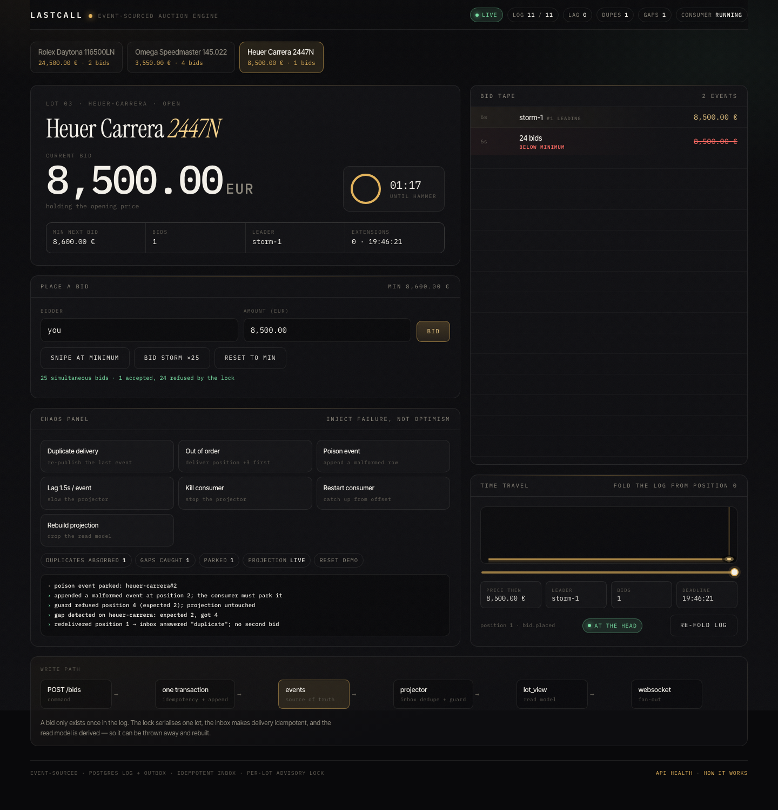

# LastCall

[](https://github.com/PepeGonzale/lastcall/actions/workflows/ci.yml)

**A live auction engine built to prove one thing: a duplicated or reordered event must never
cost anyone money.**

An event-sourced write path on Postgres, an idempotent consumer, anti-snipe deadlines that are
derived state instead of timers, and a UI with a chaos panel so the failure handling is visible
instead of claimed.



```
50 simultaneous bids for the same lot  →  1 accepted, 49 refused, 0 double charges
the same event delivered twice         →  inbox drops it, projection does not move
an event delivered out of order        →  contiguity guard refuses it, records the gap
the consumer killed mid-auction        →  restart replays from its offset, nothing lost
someone corrupts the read model        →  rebuild from the log, byte for byte
```

## Quick path

```bash
pnpm install
createdb lastcall
pnpm start          # migrates, seeds and listens on http://127.0.0.1:3333
pnpm build          # optional: builds the UI into web/dist and serves it
```

Open <http://127.0.0.1:3333>, place a bid, then open the **chaos panel** and press every lever.
Each one prints what the engine did about it.

For frontend work, `pnpm web:dev` runs Vite on `:5173` with the API and WebSocket proxied.

```bash
pnpm verify               # typecheck + 33 tests
pnpm load -- --lots=24 --bids=40   # throughput, p99, invariants
pnpm rebuild -- --verify  # rebuild snapshots from the log and compare with the projection
```

## What it actually guarantees

| Invariant | How it is enforced | How you can see it |
| --- | --- | --- |
| One bid per idempotency key | `idempotency` row written in the same transaction as the event | "Duplicate delivery" lever → `inbox answered "duplicate"` |
| No lost update under contention | `pg_advisory_xact_lock` per lot, validation inside the lock | "Bid storm ×25" → exactly one accepted |
| Dense, ordered positions per lot | positions allocated under the same lock | `events` table: positions are `0..n`, no holes |
| Effects applied exactly once | inbox insert + projection write in one transaction | restart the server: counters do not move |
| No silent reordering | per-partition contiguity guard, gaps persisted | "Out of order" lever → `guard refused position 4 (expected 2)` |
| Read model is disposable | projection rebuilt by folding the log | `pnpm rebuild -- --verify` → `0 mismatch(es)` |
| Deadline is derived, never a timer | `lot.extended` events are committed with the bid | "Snipe at minimum" inside 10s → badge + deadline jumps |
| A bad event cannot stall a lot | poison events are parked in `dead_letters` and acknowledged | "Poison event" lever → `parked` counter, next bid still lands |

## Architecture

```
        command                          facts                        derived
┌──────────────────┐   ┌──────────────────────────────┐   ┌─────────────────────┐
│ POST /bids       │   │ events (append-only)         │   │ lot_view            │
│  validate        │──▶│  partition = lotId           │──▶│  current price      │
│  decide (pure)   │   │  position  = offset          │   │  leader, bids       │
│  append + snapshot│  │  event_id  = idempotency     │   │  deadline           │
└──────────────────┘   └──────────────────────────────┘   └─────────────────────┘
        │                          │                                ▲
        │ one transaction          │ projector (at-least-once)      │
        └──────────────────────────┴─────────────── inbox + cursor ──┘
```

- **`src/domain`** — pure rules. `decideBid(state, command, now)` and one reducer. No I/O, no
  clock, no database. This is where anti-snipe lives, and it is tested without spinning anything up.
- **`src/app`** — use cases and ports: `PlaceBid`, `CloseDueLots`, `Projector`, `ReplayLog`. They
  depend on interfaces, never on `pg`.
- **`src/infra`** — Postgres adapters: event log, unit of work, projection store, read model.
- **`src/http`** — Fastify routes, Zod validation at the boundary, WebSocket fan-out.
- **`web`** — React container/presentational split, one `useAuction` reducer, design tokens in CSS.

### The five decisions that matter

| Decision | Why |
| --- | --- |
| The log **is** the outbox | A single append inside one transaction removes the classic dual write. No "saved but never published". |
| Command reads the snapshot, not the projection | The projection lags by design. An auction cannot decide the next minimum bid on stale state. |
| Inbox and effect share a transaction | At-least-once delivery becomes exactly-once *effects*. Either both commit or neither does. |
| Anti-snipe is an event, not a `setTimeout` | The deadline survives restarts, replays and out-of-order delivery because it is folded like everything else. |
| Rejections never enter the log | The log holds facts. A refused bid is a command that did not happen; it goes to `rejections` for audit. |

## Chaos panel

| Lever | What it does | Expected result |
| --- | --- | --- |
| Duplicate delivery | re-publishes the newest event | inbox absorbs it, counters tick, no second bid |
| Out of order | delivers `position + 3` first | guard refuses, writes `projector_gaps`, projection untouched |
| Poison event | appends a malformed bid the domain rejects | parked in `dead_letters`, partition advances, the next bid is unaffected |
| Lag 1.5s / event | slows the projector | `log` cursor falls behind `head` while bids keep committing |
| Kill consumer | pauses the projector | bids still land in the log; the UI stops updating |
| Restart consumer | resumes from the durable cursor | projection catches up, nothing re-applied |
| Rebuild projection | truncates the read model | it is folded back from the log; `0 mismatch` on verify |

## Measured, not claimed

Local M-series Mac, PostgreSQL 17, one Node process, HTTP round trip included. Reproduce with
`pnpm load`.

| Workload | Result |
| --- | --- |
| 960 bids across 24 lots (parallel) | **2,500–5,300 bids/s** (runs vary with laptop load), p50 3.4 ms, p99 26 ms |
| 200 bids on a single lot (serialised by the lock) | ~1,000 bids/s, p50 0.8 ms, p99 29 ms |
| 50 concurrent bids at the same price | 1 accepted, 49 refused, retry answered as duplicate |
| Orphan events (in the log, missing from the read model) | 0 |
| `rebuild --verify` after the runs | 0 mismatches |

The per-lot ceiling is lower on purpose: every bid on one lot is serialised. That is the price of
never selling a lot twice, and the reason throughput scales with lots rather than with luck.

## Tests

`pnpm test` — 34 tests, no mocks of the database. The engine tests run against a real Postgres
(`lastcall_test`), because the properties being tested are transactional.

| Suite | Covers |
| --- | --- |
| domain (19) | bid minimums, invalid amounts, closed lots, stacked anti-snipe extensions, closing rules, fold determinism |
| idempotency | retried bids and retried rejections |
| concurrency | 25 simultaneous bids → one winner; dense positions |
| projection | redelivery, out-of-order refusal, poison-event parking, catch-up after a stopped consumer, rebuild from a corrupted read model |
| replay | exact state at any point in time |
| closing | exactly one `lot.closed`; late bids refused |

## Trade-offs and what is deliberately missing

| Not included | Why, and what would change |
| --- | --- |
| Kafka | The Postgres log gives atomic append, dense offsets and at-least-once replay with one dependency. A Kafka adapter would replace `PostgresEventLog`; the projector's contract is already the same. |
| Auth, rate limiting | Out of scope for the demo; a bid would carry a signed user id and the lock would stay per lot. |
| Multi-node fan-out | `Hub` broadcasts in-process. Scaling out means each instance subscribing to the log; the partition key is already correct. |
| Dead-letter replay tooling | Parked events are inspectable in `dead_letters`; replaying them after a fix is a CLI away and deliberately not automated. |
| Snapshots per N events | The snapshot row is already O(1) per command, so folding is only used for rebuilds. |
| Exactly-once delivery | Not a thing. Exactly-once *effects* is, and that is what the inbox buys. |

## Layout

```
src/domain/auction.ts     rules + reducer (pure)
src/app/place-bid.ts      command: idempotency, decision, append
src/app/projector.ts      consumer: contiguity guard, inbox, catch-up, chaos levers
src/app/replay.ts         fold the log up to any point in time
src/infra/postgres/*      log, unit of work, projection, read model
web/src                   UI: hero, tape, chaos panel, time travel, pipeline strip
test/                     domain + engine tests (real Postgres)
docs/screenshot.png       the UI after a storm, a duplicate, a gap and a parked event
```

## Reviewer checklist

- [ ] `pnpm verify` is green.
- [ ] `pnpm load` reports `contention.verdict = PASS` and `orphanEvents = 0`.
- [ ] `pnpm rebuild -- --verify` reports `0 mismatch(es)`.
- [ ] The banana test: kill the consumer, keep bidding, restart it — the price is right and the
      counters show no duplicates.

---

Built by [José Ramón González de Vega](https://github.com/PepeGonzale).
